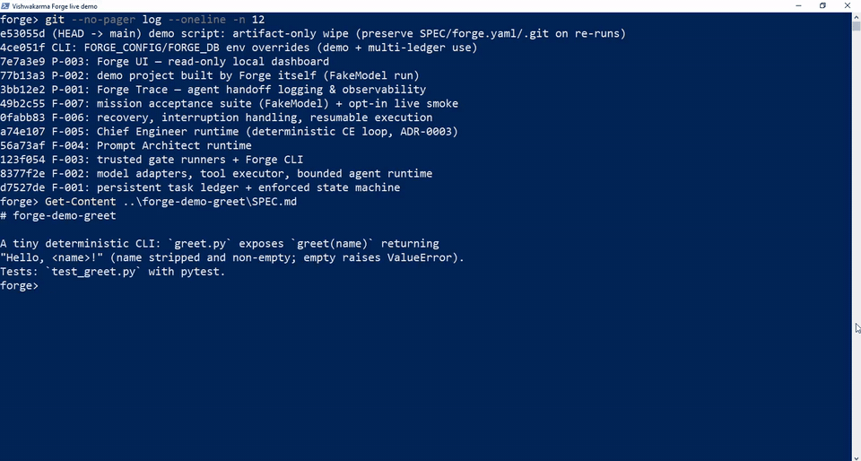
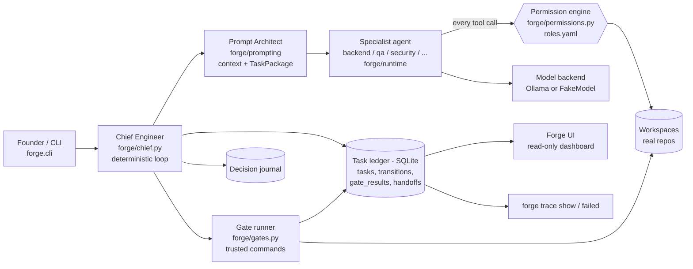

# VISHWAKARMA

> A persistent, auditable, local AI engineering organisation.

Specialist agents build, test, review, secure and operate software against real
repositories - under **code-enforced permissions**, **deterministic quality
gates** and a **persistent task ledger**. The runtime is called **Forge**. The
first product it is meant to build is **ReturnProof** (`../returnproof`).



*Recorded from a real run: Forge builds a tiny demo project with FakeModel adapters, shows the
handoff timeline and gate results, then the built project runs. A 57-second teaser is in
[`docs/media/vishwakarma-teaser.mp4`](docs/media/vishwakarma-teaser.mp4).*

## Why

Most "AI agent" setups trust the model: the agent that wrote the code also says it works.
Vishwakarma moves trust out of the model and into mechanism:

- **Permissions are code, not prompts.** Every tool call is checked against `forge/roles.yaml`
  before it runs; deny overrides allow; agents cannot grant themselves anything.
- **Autonomy is auditable.** The Chief Engineer loop is deterministic Python
  ([ADR-0003](docs/adr/ADR-0003-deterministic-chief-loop.md)); LLMs are invoked only where
  judgement is needed. Every decision is a journal row, every agent turn a transcript line,
  every state change a ledger transition.
- **Gates verify, not vibes.** Quality gates are commands declared in `forge.yaml`, run by
  Forge itself, hash-stamped into the ledger. Agents can read gate results, never write them.
- **No agent approves its own work.** Approval needs gates green *and* an independent
  reviewer verdict of CLEAN from a different role.
- **Small enough to run on a laptop.** A custom lightweight runtime
  ([ADR-0001](docs/adr/ADR-0001-custom-runtime-and-native-postgres.md)), SQLite storage, and a
  deterministic `FakeModel` so the whole pipeline is testable with no model at all.

## Architecture



Details, task lifecycle and design decisions: [docs/ARCHITECTURE.md](docs/ARCHITECTURE.md).

## Features

- **Persistent task ledger** with an enforced state machine (BACKLOG, READY, IN_PROGRESS,
  REVIEW, TESTING, CHANGES_REQUESTED, APPROVED, BLOCKED_HUMAN, CANCELLED). Illegal transitions
  raise; claiming is atomic; revision budgets escalate to a human instead of looping.
- **Permission engine + 11 role grants** (`forge/roles.yaml`): chief, software_architect,
  prompt_architect, backend, frontend, data_engineer, ml_engineer, genai_engineer, qa, security,
  devops. Code-level deny list blocks destructive commands for every role.
- **Prompt Architect runtime**: deterministic workspace retrieval, secret exclusion (no
  credential reaches a model context), versioned prompt registry with outcome tracking, validated
  `TaskPackage`s.
- **Chief Engineer runtime**: roadmap-driven task selection, dependency-aware promotion,
  specialist dispatch, trusted gates, independent review, bounded revisions, decision journal and
  daily reports.
- **Recovery and resumable execution**: interrupted runs return to READY with their retry budget
  preserved; uncommitted work is reported, never auto-reverted.
- **Forge Trace (P-001)**: an append-only handoff chain in the ledger for every agent-to-agent
  boundary - who, what context, which model, what outcome, and whether it was actually verified
  (`verified=True` only for gates green + independent review CLEAN). Secrets are redacted.
  Inspect with `forge trace show TASK` and `forge trace failed`
  ([ADR-0006](docs/adr/ADR-0006-forge-trace-handoff-observability.md)).
- **Forge UI (P-003)**: a read-only local dashboard (stdlib only, 127.0.0.1) showing tasks,
  Forge Trace timelines, gate results and state transitions.
- **Zero-cost by design**: no paid APIs. Local models via Ollama (opt-in) or the deterministic
  `FakeModel`.

## Quick start

Requires Python 3.12 or 3.13 (Windows commands shown; the project is developed on Windows).

```
py -3.12 -m venv .venv
.venv/Scripts/python -m pip install -e ".[dev]"

# verify the project
.venv/Scripts/python -m pytest
.venv/Scripts/python -m ruff check .
.venv/Scripts/python -m mypy forge

# watch Forge build a demo project end to end (FakeModel, no Ollama needed)
.venv/Scripts/python scripts/demo_greet.py

# inspect the demo build: point the CLI at the demo's own ledger
$env:FORGE_CONFIG = "..\forge-demo-greet\forge.yaml"
$env:FORGE_DB     = "..\forge-demo-greet\forge-demo.sqlite3"
.venv/Scripts/python -m forge.cli task list
.venv/Scripts/python -m forge.cli task history DEMO-1
.venv/Scripts/python -m forge.cli trace show DEMO-1

# open the read-only dashboard at http://127.0.0.1:8765/
.venv/Scripts/python -m forge.cli ui --port 8765
```

More commands and the environment overrides: [docs/USAGE.md](docs/USAGE.md).

## Demo

`scripts/demo_greet.py` runs the real Chief Engineer, ledger, prompt registry, journal, gates and
Forge Trace with `FakeModel` adapters only (no Ollama; no paid API). Forge builds a tiny
`greet.py` CLI plus tests into a separate repo (`../forge-demo-greet`): the Chief Engineer
dispatches the Prompt Architect, then the backend specialist, runs the `pytest` gate, dispatches an
independent QA review, and approves the task on the first pass. The handoff timeline and gate
hash are printed, and the built project is run and tested.

## Status and roadmap

| Milestone | Scope | State |
|---|---|---|
| F-000 | Scaffold, config, role grants, permission engine + security tests | done, gates green |
| F-001 | Persistent task ledger + state machine | done, gates green |
| F-002 | Model adapters (Ollama, FakeModel) + agent runtime | done, gates green, live round-trip verified |
| F-003 | Review gates + CLI | done, gates green, self-hosted lifecycle verified |
| F-004 | Prompt Architect runtime | done, gates green, E2E PA mission verified |
| F-005 | Chief Engineer runtime | done, gates green, autonomous mission verified |
| F-006 | Recovery + resumable execution | done, gates green, live drill verified |
| F-007 | Mission acceptance suite + opt-in live smoke | done; deterministic FakeModel missions verified; live Ollama smoke is manual, opt-in |
| P-001 | Forge Trace: handoff logging and observability | done |
| P-002 | Forge builds a demo project (FakeModel run) | done: `scripts/demo_greet.py` |
| P-003 | Forge UI: read-only local dashboard | done: `forge ui` |

Next: use Forge to build **ReturnProof** (`../returnproof`, currently a placeholder repo).

## Tests and CI

- `pytest` runs the permission attack tests and the component, mission-acceptance, trace and
  dashboard suites. On 2026-11-16: 127 passed, 1 skipped (the opt-in live Ollama smoke test),
  0 failed. `ruff check .` and `mypy forge` are clean.
- The pytest run prints one `PytestUnhandledThreadExceptionWarning` from the dashboard test
  server thread at shutdown; it does not fail the run.
- The live smoke test is opt-in: set `FORGE_LIVE_SMOKE=1` (needs a local Ollama model).
- There is no hosted CI workflow yet. The same gates are declared in `forge.yaml` and run by
  Forge itself (`forge gate run`).

## Zero-cost note

Nothing in this repository calls a paid API. The default configuration points at local Ollama
models (`deepseek-coder:6.7b`, `qwen3:0.6b`) which are optional - every test and the demo run on
the deterministic `FakeModel`.

## Governance invariants

1. Grants live in `forge/roles.yaml`; agents cannot grant themselves anything.
2. Deny overrides allow; a code-level deny list blocks destructive commands for every role.
3. No agent approves its own work; only gate-runner processes record gate results.

## License

No license file has been added yet, so all rights are reserved by default. Add a `LICENSE` file
before inviting reuse or contributions.