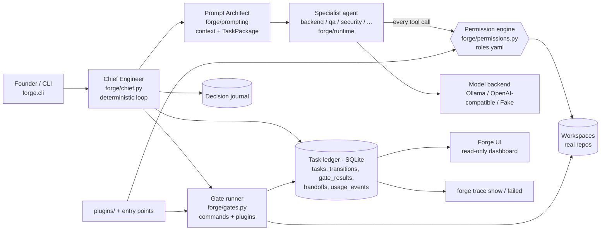

# VISHWAKARMA

> A persistent, auditable, local AI engineering organisation.

[](https://github.com/nishanttyagi28/vishwakarma/actions/workflows/ci.yml)
[](LICENSE)
[](pyproject.toml)

Specialist agents build, test, review, secure and operate software against real
repositories — under **code-enforced permissions**, **deterministic quality
gates** and a **persistent task ledger**. The runtime is called **Forge**. The
first product it is meant to build is **ReturnProof** (`../returnproof`).


*Recorded from a real run: Forge builds a tiny demo project with FakeModel adapters, shows the
handoff timeline and gate results, then the built project runs. A 57-second teaser is in
[`docs/media/vishwakarma-teaser.mp4`](docs/media/vishwakarma-teaser.mp4).*

## Why

Most “AI agent” setups trust the model: the agent that wrote the code also says it works.
Vishwakarma moves trust out of the model and into mechanism:

- **Permissions are code, not prompts.** Every tool call is checked against `forge/roles.yaml`
  before it runs; deny overrides allow; agents cannot grant themselves anything. `shell.run`
  executes argv lists with `shell=False` and rejects shell metacharacters, so allowlist prefixes
  cannot be bypassed with `&&`, `|`, `;`, `$()`, backticks or redirects.
- **Autonomy is auditable.** The Chief Engineer loop is deterministic Python
  ([ADR-0003](docs/adr/ADR-0003-deterministic-chief-loop.md)); LLMs are invoked only where
  judgement is needed. Every decision is a journal row, every agent turn a transcript line,
  every state change a ledger transition.
- **Gates verify, not vibes.** Quality gates are commands or plugin runners declared in
  `forge.yaml`, run by Forge itself, hash-stamped into the ledger. Agents can read gate results,
  never write them.
- **No agent approves its own work.** `TaskLedger.approve` itself requires TESTING state, green
  latest gate results, and a verified CLEAN verdict from a reviewer whose role differs from the
  implementer.
- **Small enough to run on a laptop.** A custom lightweight runtime
  ([ADR-0001](docs/adr/ADR-0001-custom-agent-runtime.md)), SQLite storage
  ([ADR-0002](docs/adr/ADR-0002-sqlite-ledger.md)), and a deterministic `FakeModel` so the whole
  pipeline is testable with no model at all.

## Architecture



Details, task lifecycle and design decisions: [docs/ARCHITECTURE.md](docs/ARCHITECTURE.md).
Plugin authors: [docs/PLUGINS.md](docs/PLUGINS.md).

## Features

- **Persistent task ledger** with an enforced state machine (BACKLOG, READY, IN_PROGRESS,
  REVIEW, TESTING, CHANGES_REQUESTED, APPROVED, BLOCKED_HUMAN, CANCELLED). Illegal transitions
  raise; claiming and its history row commit atomically; revision budgets escalate to a human
  instead of looping.
- **Approval invariants in the ledger**: TESTING state, latest trusted gates green, and a
  verified CLEAN independent review are required for every approval — CLI, Chief Engineer or
  future caller.
- **Permission engine + 11 role grants** (`forge/roles.yaml`): chief, software_architect,
  prompt_architect, backend, frontend, data_engineer, ml_engineer, genai_engineer, qa, security,
  devops. Governance files are not writable by agents. Code-level deny lists and a
  metacharacter-free shell block destructive or chained commands for every role.
- **Prompt Architect runtime**: deterministic workspace retrieval, secret exclusion (no
  credential reaches a model context), versioned prompt registry with outcome tracking, validated
  `TaskPackage`s. `repo.search`, `prompt.save` and `ledger.query` are real permission-checked tools.
- **Chief Engineer runtime**: roadmap-driven task selection, dependency-aware scheduling,
  optional parallel workers for independent tasks, specialist dispatch, trusted gates,
  independent review, bounded revisions, decision journal and daily reports.
- **Portable gates and configuration**: repo-relative workspaces, `{python}` resolves to the
  running interpreter, and a missing interpreter/workspace is a recorded FAILED gate rather than
  a crash. The suite is designed to pass on Linux and Windows.
- **Recovery and resumable execution**: interrupted runs return to READY with their retry budget
  preserved; uncommitted work is reported, never auto-reverted.
- **Forge Trace**: an append-only handoff chain for every agent-to-agent boundary — who, what
  context, which model, what outcome, and whether it was actually verified (`verified=True` only
  for gates green + independent review CLEAN). Secrets are redacted. Inspect with
  `forge trace show TASK` and `forge trace failed`
  ([ADR-0006](docs/adr/ADR-0006-forge-trace-handoff-observability.md)).
- **Token/cost budgets**: append-only `usage_events` per task and per mission, shown in Forge
  Trace and the UI, with optional task/mission token and USD limits.
- **Pluggable models**: local Ollama, an OpenAI-compatible HTTP adapter configured by
  `FORGE_OPENAI_*` (DeepSeek, OpenRouter, gateways), and the deterministic `FakeModel`.
- **Forge UI**: read-only, GET-only, loopback-only dashboard with task detail pages, mission
  timelines, gate-result diffs, a handoff graph and auto-refresh.
- **Plugin system**: add custom gate runners and new roles from `plugins/` or Python entry points;
  plugins cannot override built-in roles.
- **Quality gates for the project itself**: MIT license, GitHub Actions on Ubuntu and Windows,
  `ruff`, strict `mypy` and pytest with an enforced 88% coverage floor.

## Quick start

Requires Python 3.12 (3.13 also works). The commands below are cross-platform; use
`.venv/bin/python` on Linux/macOS or `.venv/Scripts/python` on Windows.

```bash
python -m venv .venv
# Linux/macOS: source .venv/bin/activate
# Windows:     .venv\Scripts\activate
python -m pip install -e ".[dev]"

# verify the project
python -m pytest
python -m ruff check .
python -m mypy forge

# watch Forge build a demo project end to end (FakeModel, no Ollama needed)
python scripts/demo_greet.py

# after `pip install -e .`, the `forge` entry point is available
forge status

# open the read-only dashboard at http://127.0.0.1:8765/
forge ui --port 8765
```

The demo builds into a temporary directory (`FORGE_DEMO_DIR` overrides it) with its own ledger.
More commands, environment overrides and UI views: [docs/USAGE.md](docs/USAGE.md).

## Demo

`scripts/demo_greet.py` runs the real Chief Engineer, ledger, prompt registry, journal, gates and
Forge Trace with `FakeModel` adapters only (no Ollama; no paid API). Forge builds a tiny
`greet.py` CLI plus tests into a separate folder: the Chief Engineer dispatches the Prompt
Architect, then the backend specialist, runs the `pytest` gate, dispatches an independent QA
review, and approves the task on the first pass. The handoff timeline and gate hash are printed,
and the built project is run and tested.

## Status and roadmap

Foundation milestones:

| Milestone | Scope | State |
|---|---|---|
| F-000 | Scaffold, config, role grants, permission engine + security tests | done |
| F-001 | Persistent task ledger + state machine | done |
| F-002 | Model adapters (Ollama, FakeModel) + agent runtime | done |
| F-003 | Review gates + CLI | done |
| F-004 | Prompt Architect runtime | done |
| F-005 | Chief Engineer runtime | done |
| F-006 | Recovery + resumable execution | done |
| F-007 | Mission acceptance suite + opt-in live smoke | done |
| P-001 | Forge Trace: handoff logging and observability | done |
| P-002 | Forge builds a demo project (FakeModel run) | done |
| P-003 | Forge UI: read-only local dashboard | done |

Advanced hardening milestones (details in [docs/ADVANCED_PROGRESS.md](docs/ADVANCED_PROGRESS.md)):

| Milestone | Scope | State |
|---|---|---|
| A-001 | Shell tool security: argv execution, metacharacter rejection, tool grants | done |
| A-002 | Portable gates/configuration: `{python}`, relative workspaces, failed-not-crash gates | done |
| A-003 | Ledger invariants: approval evidence, atomic claim, governance files read-only to agents | done |
| A-004 | CLI/Chief refactor, `forge` entry point, typed exit codes, `--model` selection | done |
| A-005 | Docs truth: ADR-0002 SQLite, per-task UI, real named tools | done |
| A-006 | Repo hygiene: MIT license, Ubuntu/Windows CI, strict mypy, 88% coverage floor | done |
| A-007 | Per-task/per-mission token and cost budgets, OpenAI-compatible adapter | done |
| A-008 | Parallel dependency-DAG execution with configurable workers | done |
| A-009 | UI: task detail, mission timeline, gate diffs, handoff graph, auto-refresh | done |
| A-010 | Plugin system for custom gate runners and additive roles | done |

Next: use Forge to build **ReturnProof** (`../returnproof`, currently a placeholder repo).

## Tests and CI

- GitHub Actions runs the same gates on `ubuntu-latest` and `windows-latest` with Python 3.12:
  `ruff check .`, `mypy forge`, and pytest with coverage.
- On 2026-11-16: **202 passed, 1 skipped** (the opt-in live Ollama smoke test), coverage
  **90.44%**, with an enforced 88% floor. `ruff check .` and `mypy forge` are clean.
- All mission, gate, model, plugin, parallel-execution and UI tests use `FakeModel` or mocked
  HTTP. No Ollama server or live LLM is started by the test suite.
- The live smoke test is opt-in: set `FORGE_LIVE_SMOKE=1` (needs a local Ollama model).

## Zero-cost note

Nothing in this repository calls a paid API by default. Local Ollama models are optional; every
test and the demo run on the deterministic `FakeModel`. The OpenAI-compatible adapter is inert
until an operator sets `FORGE_OPENAI_BASE_URL`, `FORGE_OPENAI_MODEL` and (typically)
`FORGE_OPENAI_API_KEY`, and its tests use mocked HTTP only.

## Governance invariants

1. Grants live in `forge/roles.yaml`; agents cannot grant themselves anything, and governance
   files are not writable by any agent.
2. Deny overrides allow; a code-level deny list blocks destructive commands; the shell tool
   never invokes a shell.
3. No agent approves its own work: approval requires green latest gates and an independent CLEAN
   review recorded in the ledger.
4. Only the trusted gate runner records gate results; results and audit rows are append-only and
   hash-stamped.

## License

MIT — Copyright 2026 Nishant Tyagi. See [LICENSE](LICENSE).

## How this was built

Most of the code was written by an AI coding agent (DeepAI Code running DeepSeek) working through the milestones in `docs/`. I wrote the milestone specs, ran the test suite and reviewed the results before each commit.
