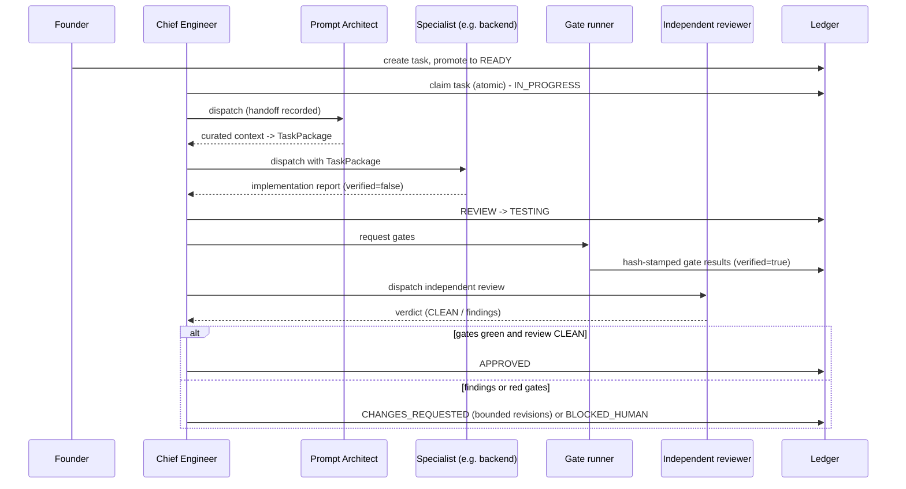

# Architecture

Vishwakarma is a small, deterministic orchestration layer (**Forge**) around LLM agents. The
guiding rule: *mechanism decides, models advise*. Permissions, state transitions, gates and
approval are plain Python and SQLite; models are used only for judgement inside bounded,
transcripted, permission-checked runs.

Design decisions live in [`docs/adr/`](adr/):

| ADR | Decision |
|---|---|
| [ADR-0001](adr/ADR-0001-custom-runtime-and-native-postgres.md) | Lightweight custom agent runtime instead of LangGraph/CrewAI/AutoGen |
| [ADR-0003](adr/ADR-0003-deterministic-chief-loop.md) | The Chief Engineer loop is deterministic mechanism invoking LLM agents |
| [ADR-0006](adr/ADR-0006-forge-trace-handoff-observability.md) | Forge Trace: append-only handoff observability in the ledger |

## Components

| Module | Responsibility |
|---|---|
| `forge/config.py`, `forge.yaml` | Workspaces, model assignment, limits, trusted gate commands |
| `forge/permissions.py`, `forge/roles.yaml` | Per-role grants (fs read/write globs, shell allow-list, tools); code-level deny list; checked before every tool call |
| `forge/ledger.py` | SQLite task ledger and enforced state machine; four tables: `tasks`, `transitions`, `gate_results`, `handoffs` |
| `forge/gates.py` | Trusted gate runners: commands from `forge.yaml`, executed by Forge, results hash-stamped; the only writer of `gate_results` |
| `forge/model/` | `ModelBackend` protocol; `OllamaBackend` (local HTTP, sequential use) and `FakeModel` (scripted, deterministic) |
| `forge/runtime/` | Bounded strict-JSON agent loop (`agent.py`) and permission-checked tool executor (`tools.py`) |
| `forge/prompting/` | Prompt Architect: retrieval, secret exclusion, versioned prompt registry, `TaskPackage` schema and packager |
| `forge/chief.py` | Chief Engineer: deterministic goal loop, dispatch, gates, independent review, approval, escalation, daily report |
| `forge/journal.py` | Append-only decision journal (SQL-trigger enforced) |
| `forge/recovery.py` | Interrupted-run detection, safe resumption, retry budgeting |
| `forge/cli.py` | Human and Chief interface: `task`, `gate`, `status`, `trace`, `recover`, `ui`, `chief` |
| `forge/webui.py` | Read-only dashboard on 127.0.0.1 (stdlib `http.server`) |

## Flow of one task

Task states: `BACKLOG -> READY -> IN_PROGRESS -> REVIEW -> TESTING -> APPROVED`, with
`CHANGES_REQUESTED`, `BLOCKED_HUMAN` and `CANCELLED` as side exits. An illegal transition raises
`LedgerError`. A task that exceeds `max_revisions_per_task` escalates to `BLOCKED_HUMAN`. Tasks
marked human-gated can only be approved by the `founder` actor.

## Trust boundaries

- **Roles and permissions.** `roles.yaml` is the single source of truth. The permission engine is
  consulted for every tool call; agents cannot edit the effect of the file. The Chief Engineer
  never writes product source code - delegation is its only code path.
- **Gates.** Declared in `forge.yaml`, run by Forge. Agents may read results, not produce them.
- **Verification honesty.** A report handoff is never marked verified for merely returning text.
  `verified=True` is recorded only for gates green plus independent review CLEAN (ADR-0006).
- **Secrets.** `forge/prompting/secrets.py` excludes sensitive files from agent context; handoff
  objective and detail are passed through `redact_text` before insert.
- **Append-only audit.** `transitions`, `gate_results`, `handoffs` and the decision journal are
  write-once, enforced with SQL triggers.
- **Recovery.** Interrupted tasks return to READY with the retry budget preserved; uncommitted
  changes are reported and only reverted by an explicit CLI flag.

## Observability

- **Forge Trace** (`handoffs` table): sender, receiver, kind (dispatch / report / verdict / gates /
  failure / retry / block), objective, prompt id and version, context refs, model, status,
  verified flag, redacted detail, parent linkage forming one connected timeline per task.
  CLI: `forge trace show TASK`, `forge trace failed`.
- **Forge UI**: read-only dashboard over the same ledger - tasks, handoff timeline, gate results,
  state transitions. Binds to 127.0.0.1 only; GET only.
- **Transcripts**: raw agent turns are written as JSONL under `runs/` (git-ignored); handoff rows
  carry summaries to avoid duplicating them.

## Models

Models are pluggable behind `ModelBackend`. `OllamaBackend` talks to a local Ollama server and is
used strictly sequentially (one shared local model, low-RAM friendly). `FakeModel` replays scripted
replies, which is how the test suite, the mission acceptance suite and the demo run with no model.