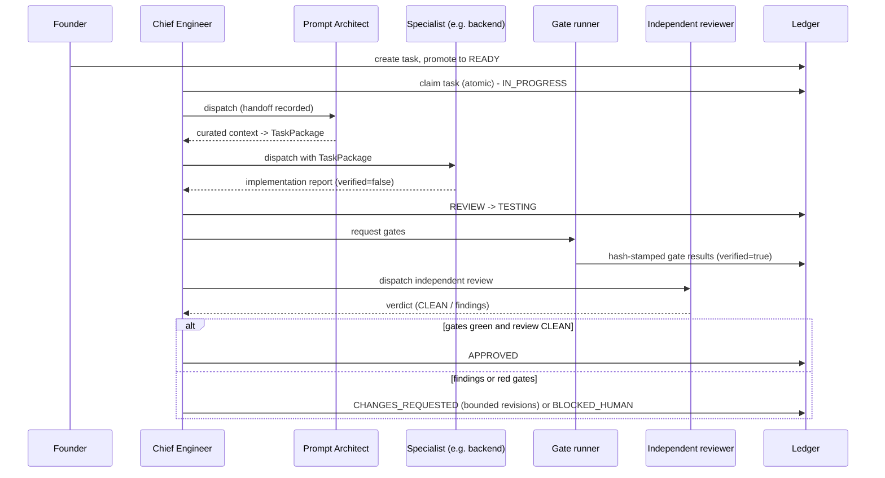

# Architecture

Vishwakarma is a small, deterministic orchestration layer (**Forge**) around LLM agents. The
guiding rule: *mechanism decides, models advise*. Permissions, state transitions, gates and
approval are plain Python and SQLite; models are used only for judgement inside bounded,
transcripted, permission-checked runs.

Design decisions live in [`docs/adr/`](adr/):

| ADR | Decision |
|---|---|
| [ADR-0001](adr/ADR-0001-custom-agent-runtime.md) | Lightweight custom agent runtime instead of LangGraph/CrewAI/AutoGen |
| [ADR-0002](adr/ADR-0002-sqlite-ledger.md) | SQLite ledger (supersedes the earlier PostgreSQL proposal) |
| [ADR-0003](adr/ADR-0003-deterministic-chief-loop.md) | The Chief Engineer loop is deterministic mechanism invoking LLM agents |
| [ADR-0006](adr/ADR-0006-forge-trace-handoff-observability.md) | Forge Trace: append-only handoff observability in the ledger |

## Components

| Module | Responsibility |
|---|---|
| `forge/config.py`, `forge.yaml` | Workspaces, model assignment, limits, trusted gate commands |
| `forge/permissions.py`, `forge/roles.yaml` | Per-role grants (fs read/write globs, shell allow-list, tools); code-level deny list; checked before every tool call |
| `forge/ledger.py` | SQLite task ledger and enforced state machine; five append-oriented tables: `tasks`, `transitions`, `gate_results`, `handoffs`, `usage_events` |
| `forge/gates.py` | Trusted gate runners: commands from `forge.yaml` or plugin runners, executed by Forge, results hash-stamped; the only writer of `gate_results` |
| `forge/model/` | `ModelBackend` protocol; `OllamaBackend` (local HTTP), `OpenAICompatibleBackend` (env-configured), `FakeModel` (scripted), and `ModelUsage` token/cost accounting |
| `forge/runtime/` | Bounded strict-JSON agent loop (`agent.py`) and permission-checked tool executor (`tools.py`) |
| `forge/prompting/` | Prompt Architect: retrieval, secret exclusion, versioned prompt registry, `TaskPackage` schema and packager |
| `forge/chief.py` | Chief Engineer: deterministic DAG scheduler (optional parallel workers), dispatch, gates, independent review, approval, budget enforcement, escalation, daily report |
| `forge/journal.py` | Append-only decision journal (SQL-trigger enforced) |
| `forge/recovery.py` | Interrupted-run detection, safe resumption, retry budgeting |
| `forge/plugins.py`, `plugins/` | Discovery of custom gate runners and additive roles from entry points or a folder |
| `forge/cli.py` | Human and Chief interface: `task`, `gate`, `status`, `trace`, `recover`, `ui`, `chief` |
| `forge/webui.py` | Read-only, loopback-only dashboard: task detail, mission timeline, handoff graph, gate diffs, auto-refresh (stdlib `http.server`) |

## Flow of one task

Task states: `BACKLOG -> READY -> IN_PROGRESS -> REVIEW -> TESTING -> APPROVED`, with
`CHANGES_REQUESTED`, `BLOCKED_HUMAN` and `CANCELLED` as side exits. An illegal transition raises
`LedgerError`. A task that exceeds `max_revisions_per_task` escalates to `BLOCKED_HUMAN`. Tasks
marked human-gated can only be approved by the `founder` actor.

`TaskLedger.approve` enforces the evidence rule itself: the task must be TESTING, every latest
gate result must pass, and the latest review verdict must be CLEAN, verified, and recorded by a
role other than the implementer. A CLI shortcut cannot bypass this.

## Execution and concurrency

`run_roadmap` syncs the roadmap, promotes/claims ready tasks in roadmap order, and batches them.
A dependent task becomes ready in the next batch only after all dependencies are APPROVED. When
`limits.max_parallel_workers > 1` **and** a per-task model factory is supplied, a batch runs in a
thread pool; each worker gets its own ledger, prompt-registry and journal SQLite connections and
fresh model backends. Without a factory, or with one ready task, execution stays sequential because
a shared model backend is sequential-use only. Reported outcomes keep roadmap order for
determinism. SQLite connections use a 30s busy timeout for transient contention.

## Trust boundaries

- **Roles and permissions.** `roles.yaml` is the single source of truth. The permission engine is
  consulted for every tool call; agents cannot edit the effect of the file, and no agent may write
  governance files (`roles.yaml`, `permissions.py`, `ledger.py`, `gates.py`, `chief.py`, `cli.py`).
  The shell tool runs argv lists with `shell=False`; shell metacharacters are refused before the
  allowlist is consulted. The Chief Engineer never writes product source code - delegation is its
  only code path.
- **Gates.** Declared in `forge.yaml`, run by Forge. Command gates are argv-only; plugin runners
  are trusted operator code. Agents may read results, not produce them.
- **Verification honesty.** A report handoff is never marked verified for merely returning text.
  `verified=True` is recorded only for gates green plus independent review CLEAN (ADR-0006).
- **Secrets.** `forge/prompting/secrets.py` excludes sensitive files from agent context; handoff
  objective and detail are passed through `redact_text` before insert.
- **Append-only audit.** `transitions`, `gate_results`, `handoffs`, `usage_events` and the
  decision journal are write-once, enforced with SQL triggers.
- **Plugins.** Trusted operator code only, discovered from `vishwakarma.plugins` entry points or
  `plugins/`. Plugin roles are additive; a plugin cannot override a built-in role, and broken or
  unknown gate runners are recorded as FAILED gates.
- **Recovery.** Interrupted tasks return to READY with the retry budget preserved; uncommitted
  changes are reported and only reverted by an explicit CLI flag.

## Observability

- **Forge Trace** (`handoffs` table): sender, receiver, kind (dispatch / report / verdict / gates /
  failure / retry / block), objective, prompt id and version, context refs, model, status,
  verified flag, redacted detail, parent linkage forming one connected timeline per task.
  CLI: `forge trace show TASK`, `forge trace failed`.
- **Usage** (`usage_events` table): per task and per mission prompt/completion tokens, USD cost,
  role and model. CLI trace prints usage rows; the UI shows task usage and mission summaries.
- **Forge UI**: read-only dashboard over the same ledger - task list/detail, mission timeline,
  handoff graph, gate results and consecutive-result diffs, state transitions, auto-refresh.
  Binds to 127.0.0.1 only; GET only.
- **Transcripts**: raw agent turns are written as JSONL under `runs/` (git-ignored); handoff rows
  carry summaries to avoid duplicating them.

## Models

Models are pluggable behind `ModelBackend`. `OllamaBackend` talks to a local Ollama server and is
typically used sequentially (one shared local model, low-RAM friendly).
`OpenAICompatibleBackend` speaks the `/chat/completions` protocol to any compatible endpoint
configured through `FORGE_OPENAI_*`; its tests use mocked HTTP only. `FakeModel` replays scripted
replies (and scripted usage), which is how the test suite, the mission acceptance suite and the
demo run with no model. Backends expose `last_usage`; the runtime accumulates it and the Chief
Engineer records it against the task, mission and optional budgets.